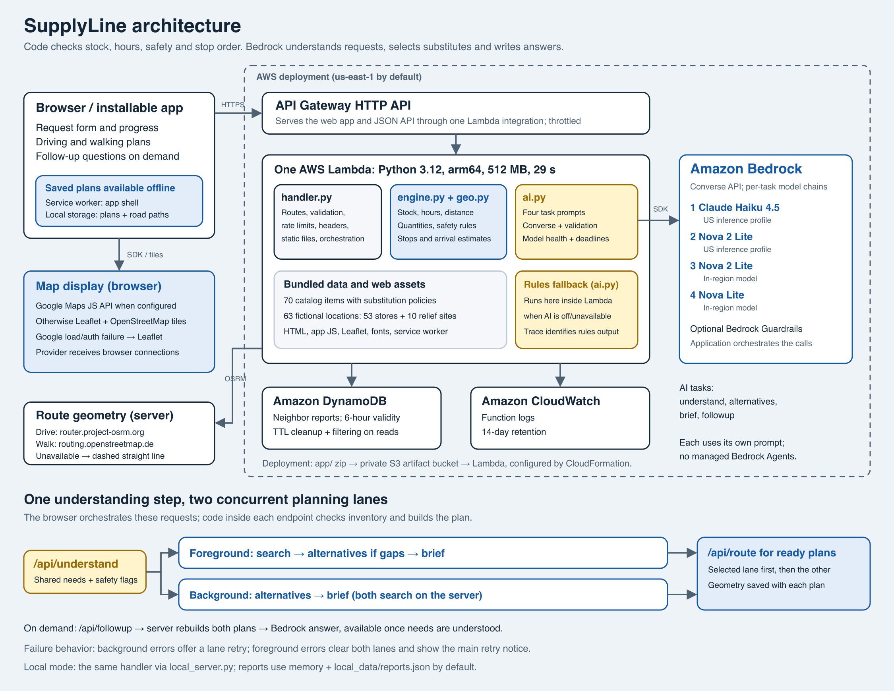

# SupplyLine

**When a disaster hits, tell SupplyLine what happened and what you need. It finds the nearest open stores that have it in stock, plans one short route, and when nobody has an item it finds a safe substitute that does the same job.**

Built for SpartHill Hacks 2026, AWS Track. Amazon Bedrock does the language work inside the app. Plain, testable code does the stock, hours and routing.



## The persona

**Maria, a family caregiver in San José.** A wildfire warning has just gone out and the power is off. Her father uses insulin that must stay cold. Her baby needs formula and diapers. She has a phone with a weak signal and a few minutes. She does not know which store still has anything, and she does not know what is safe to use instead.

(Maria is a composite persona, not a real person.)

The critical service is **getting essential supplies to a household during a disruption**. Search engines and map apps return a list of stores. They do not know that a store closes before you arrive, that D batteries sold out across downtown, or that you must not swap baby formula for something else.

## What it does

1. **Understands a messy request.** Free text like "dad uses insulin, baby needs formula" becomes a list of supplies from a fixed 70-item catalog, and it adds the needs people forget (a cooler and ice for the insulin).
2. **Finds real availability.** For each item it checks stock, how old the stock data is, and whether the store will still be open when you arrive.
3. **Plans a route.** Up to 4 stops that cover everything, with the most urgent items first. The map draws the fastest road route through them in that order, and one tap opens the whole trip in Google Maps for turn-by-turn with live traffic.
4. **Finds alternatives when something is out.** Amazon Bedrock picks substitutes, but only from items confirmed in stock near you, and only from a hand-written safe list for risky items.
5. **Explains it in plain language.** A short briefing, a follow-up question box, and copy, text-message and print options.
6. **Takes neighbor reports.** "Has it", "Running low", "Sold out", "It is closed". Reports expire after 6 hours.
7. **Never gambles with safety.** See below.

## Safety design

Every catalog item has a policy:

| Policy | Meaning | Example |
|---|---|---|
| `free` | Any in-stock item with the same use is fine. | Bottled water for canned water |
| `caution` | Only items on a hand-written allowlist, with a warning shown. The list can be empty. | 1 lb propane: ready-to-eat food as a cooking workaround; no incompatible fuel swaps |
| `none` | Never substituted. The app says who to call instead. | Insulin, prescriptions |

The model's output is checked against these rules in code (`ai.py` and again in `engine.py`). The model cannot add an item that is not in the catalog, cannot suggest something out of stock, and cannot override the policy. The "safe to swap" verdict is worked out on the server, never trusted from the browser. A keyword safety net shows a **call 911** banner for things like gas smell or chest pain, even if the model misses it.

The catalog has no package-size conversion data. When more than one unit is requested and only substitutes are available, the app keeps the requested amount unresolved and asks the user to confirm equivalent quantities with the store. It shows the options without automatically adding an unverified purchase to the route.

## Run it locally (about 60 seconds)

You need Python 3.12 or newer. Nothing else is required to try it.

```bash
cd supplyline
python3 local_server.py --ai off      # rules only, no AWS needed
# open http://localhost:8080
```

Type a request and press **Enter** to search (Shift+Enter adds a new line). The map background and the road route need an internet connection. Without one, the app still works and the map shows a straight dashed line.

On Windows (PowerShell or Command Prompt):

```powershell
py local_server.py --ai off --roads on
```

`--ai off` disables AI only. `--roads on` explicitly enables street routing even if `ROAD_ROUTING=off` was left in the environment. Restart the server after pulling code changes. If the route stays straight, the message below the map now gives the server's reason. Check road connectivity separately with:

```powershell
py local_server.py --roads on --check-routing
```

This checks a fixed San Jose demo route, prints the number of street vertices on success, and exits with a nonzero status on failure. On Windows, a failed Python connection also tries Windows PowerShell's native HTTPS stack with certificate verification enabled. This can recover from differences in certificate-chain or proxy handling; it cannot override a network firewall or routing-service outage.

To use real Amazon Bedrock locally, put your AWS credentials in the environment first (on the event page click **Get AWS CLI credentials** and paste the exports), install boto3 (`pip install boto3`), then:

```bash
python3 local_server.py               # --ai auto: Bedrock, falls back to rules if it fails
python3 scripts/smoke.py              # proves Bedrock answers; exits 1 if any stage fell back
```

## Deploy to AWS

Needs the AWS CLI and Python 3 on your machine, working credentials, and the `us-east-1` region.

```bash
bash scripts/deploy.sh                # about a minute the first time
python3 scripts/smoke.py <the URL it prints>
bash scripts/destroy.sh               # remove everything when you are done
```

`deploy.sh` builds a zip of `app/`, uploads it to a private S3 bucket, and runs CloudFormation (`infra/template.yaml`). The stack creates one Lambda function (Python 3.12, arm64) behind an API Gateway HTTP API, a DynamoDB table with a 6-hour TTL for neighbor reports, a log group with 14-day retention, and a least-privilege IAM role.

Optional settings (environment variables for `deploy.sh`): `AWS_REGION`, `STACK_NAME`, `BEDROCK_REGION`, `BEDROCK_MODEL_IDS` (comma separated), `GUARDRAIL_ID`.

Road routing can be tuned on the function with `ROAD_ROUTING=off` (never call the routing service) or `ROAD_ROUTING_URL` (point at your own OSRM-compatible server).

### Which models

Tried in this order. The first one that answers wins, and failures are remembered for a while so the app does not waste time retrying them.

1. `us.anthropic.claude-haiku-4-5-20251001-v1:0`
2. `us.amazon.nova-2-lite-v1:0`
3. `amazon.nova-2-lite-v1:0`
4. `amazon.nova-lite-v1:0`

If every model fails, the app still answers with the rules fallback and says so on screen. It never pretends the model ran.

### Bedrock Guardrails (optional)

Create a guardrail in the Bedrock console, then `GUARDRAIL_ID=<id> bash scripts/deploy.sh`. The Converse calls will include it. Use the guardrail ID, not its ARN or name.

The stack also allows the function role `bedrock:ApplyGuardrail` on that one guardrail in `BEDROCK_REGION`, which Bedrock requires on top of model invocation. Without it every call is denied and the app answers from rules. A guardrail with cross-Region inference turned on needs more permissions on its guardrail profiles, which the template does not grant ([AWS docs](https://docs.aws.amazon.com/bedrock/latest/userguide/guardrail-profiles-permissions.html)).

## How it maps to the judging rubric

| Rubric item | Where to see it |
|---|---|
| Real persona and need (20) | Maria above. Wildfire, insulin and a baby are the first example in the app. |
| Working app (25) | Live URL after `deploy.sh`. Works offline for the last plan. 4 automated test files. |
| AWS AI use (20) | Four Bedrock stages (understand, alternatives, briefing, follow-up) via the Converse API, with a model fallback chain, optional Guardrails, and a trace panel ("Under the hood: what Bedrock did", folded away by default) that shows the model, time and tokens for each call. |
| Understanding what you built (15) | [docs/ARCHITECTURE.md](docs/ARCHITECTURE.md): what is code, what is the model, and why. |
| Polish (10) | Accessible, mobile first, installable, prints, no external CDN (only map tile images come from OpenStreetMap), checked at phone width. |
| Above and beyond (10) | Safety policy per item, stock freshness, open-on-arrival checks, urgency-weighted routing, neighbor reports with expiry, graceful fallback, one-command deploy and teardown. |

The video script is in [docs/DEMO_SCRIPT.md](docs/DEMO_SCRIPT.md).

## Honest limits

* **The data is fictional.** 53 invented stores in 16 San José neighborhoods and made-up stock, generated with a fixed seed (`scripts/gen_data.py`). It shows how the app behaves in a shortage. It is not a real inventory feed.
* **The demo stock ages in real time.** Each record's "checked N minutes ago" is counted from one snapshot time (the deploy time on AWS, the server start locally), so "fresh" stock turns into "call ahead" after a few hours. A neighbor report stays in force for its 6 hours, because it is compared with that same snapshot time. Redeploy to refresh the demo data.
* **Drive times in the plan are estimates** (straight-line distance, a detour factor and a slow fixed speed). There is no live traffic and no road closures.
* **The road route on the map comes from a free public service.** It uses the public OSRM demo server with OpenStreetMap data. That service has no uptime promise and no live traffic, so if it is down the map shows a straight dashed line and says so. Its time can differ from the plan's estimate, which is deliberately slower and includes shopping time. Your function (not the browser) calls it, so only the coordinates of your location and the stops are sent, never your IP address. For production use Amazon Location Service.
* **The rules fallback is much weaker than the model.** It matches keywords. It is there so the app is never dead, not to replace the model. Its substitutes come from a short hand-written list (`FALLBACK_SUBS` in `ai.py`), so many items get none. Batteries never get one, because it cannot tell what they are for and a different size will not fit.
* **Neighbor reports are unverified.** Anyone can post one, so a bad actor could mislead. The only protection today is a 6-hour expiry, a per-IP rate limit and input validation.
* **No accounts and only basic rate limiting.**
* **Opening hours are read in Pacific time** because the demo region is San José.
* This is a hackathon prototype, not a replacement for emergency services.

### Roadmap

Real inventory (retailer or point-of-sale APIs), live traffic and road closure data (for example Amazon Location Service), report verification and reputation, SMS access through Amazon Pinpoint or SNS for people without data, more languages with Amazon Translate, and an evacuation-zone layer.

## Repository layout

```
app/
  handler.py     Lambda entry point: routes, validation, rate limit, security headers, static files
  engine.py      Search, store hours, route planning, safety policy enforcement (no AI)
  ai.py          Amazon Bedrock stages, validation, model fallback, rules fallback
  roads.py       Road route for the map (public OSRM service, fails soft)
  road_transport.py  HTTPS fetch, with a native Windows fallback for connection failures
  store.py       Neighbor reports (DynamoDB, or in memory locally)
  geo.py         Distance and travel time
  data/          catalog.json, stores.json, places.json (generated)
  static/        The web app: index.html, app.js, styles.css, service worker, map, fonts
infra/template.yaml   CloudFormation stack
scripts/              deploy.sh, destroy.sh, smoke.py, gen_data.py
tests/                Engine, AI, handler and AWS request-shape tests
docs/                 Architecture diagram and notes, demo script
local_server.py       Run the same Lambda handler on your laptop
```

## Tests

```bash
pip install boto3 moto      # only needed for the AWS shape tests, which skip if missing
python3 -m unittest discover -s tests -p "test_*.py" -v
```

The tests use a scripted fake Bedrock client for the pipeline and a real boto3 client with a stubber for request shapes (so a misspelled Converse field fails a test), and moto for DynamoDB. They cover the safety rules, route ordering, error handling, the road-route client (with the network mocked) and the HTTP layer. They do not call real AWS or the real routing service.

For browser regressions, install Chrome and run:

```bash
pip install playwright
python3 scripts/browser_regressions.py
```

This starts an isolated local server and Chrome session. It checks Enter and Shift+Enter, mobile search events, delayed location loading, location selection, saved plans, road geometry and retry, stale route responses, responsive layout, and offline cache updates. Routing is mocked and AI is disabled. Alternatively, run `playwright install chromium` and set `BROWSER_CHANNEL=chromium`.

GitHub Actions runs the backend and browser regressions on Linux and Windows. The Windows tests exercise a real PowerShell request to a local fixture and verify that an untrusted HTTPS certificate is rejected.

## Troubleshooting

| Symptom | Fix |
|---|---|
| `smoke.py` says a stage "fell back" with `AccessDeniedException` | Open the Bedrock console in `us-east-1`, check the model catalog and request or enable access for the model. Anthropic models may ask for a one-time use case form. The other models in the chain will be tried meanwhile. |
| Every model fails but the first few worked before | Throttling. Failures are remembered for 20 seconds, then retried. |
| Error about an inference profile or `us.` model | Your account may block cross-region profiles. The chain already falls through to in-region Nova models. Or set `BEDROCK_MODEL_IDS` to a model you can use. |
| `no credentials` in the trace | Export credentials (local) or check the Lambda role (deployed). The app answers with rules in the meantime. |
| Request takes too long | The Lambda limit is 29 seconds (the API Gateway limit). Each stage may use up to 24 seconds of model time, never more than the request has left minus a 3 second reserve. Each call gets a timeout that fits in the time left, the SDK never retries on its own, and no call or JSON repair starts with under 5 seconds left. Then the app falls back to rules. |
| The map line is dashed and straight | The routing service could not be reached (the function may have no internet, or the free service is busy). The dashed line connects stops; it is not a driving route. Click **Retry road route** or open **Turn-by-turn in Google Maps**. Transient routing failures are retried once automatically. |
| Map background blank | Map tiles come from OpenStreetMap and need a network. They also need the browser to send a Referer, so the app sets `Referrer-Policy: strict-origin-when-cross-origin`. A privacy extension that strips Referer will blank the tiles. The app shows a notice, and the route, stops and list still work. |
| `deploy.sh` fails on the bucket | Set `ARTIFACT_BUCKET` to a bucket you own, or check your credentials with `aws sts get-caller-identity`. |

## Contact

Add your team name and a contact (email or Slack handle) here and say it in the video, as the challenge asks.

## Credits

Fonts: Overpass and Atkinson Hyperlegible (open licenses in `app/static/fonts`). Map library: Leaflet (BSD, `app/static/vendor`). Map tiles come from OpenStreetMap contributors when online.
